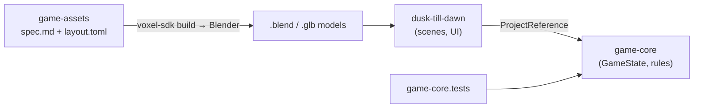

# Architecture overview

```
DuskTillDawn/
├─ dusk-till-dawn/     Godot 4.7 .NET project: scenes, nodes, UI (C#)  → godot-project.md
├─ game-core/          Plain C# library: GameState + game rules         → game-core.md
├─ game-core.tests/    xUnit tests for game-core                        → game-core.md
├─ game-assets/        Voxel Elements (spec + layout) and the voxel SDK → asset-pipeline.md
├─ scripts/            One-off and dev scripts                          → ci-and-tools.md
├─ docs/               Human-owned: contract, game-v1, ADRs, specs, ideas
├─ agent_context/      This folder: rules and maps for agents
└─ .claude/skills/     Project skills: create-ui, blender-voxel-py, csharp-godot, game-pr-review
```

Exact file per task: [where-to-change.md](where-to-change.md).

## How the parts depend on each other



## One rule shapes the code

All game state lives in `game-core` (`GameState`). Godot nodes only **show** state
and forward player actions. This keeps the rules testable without Godot and keeps
co-op possible later (`docs/contract.md` §3.1).
