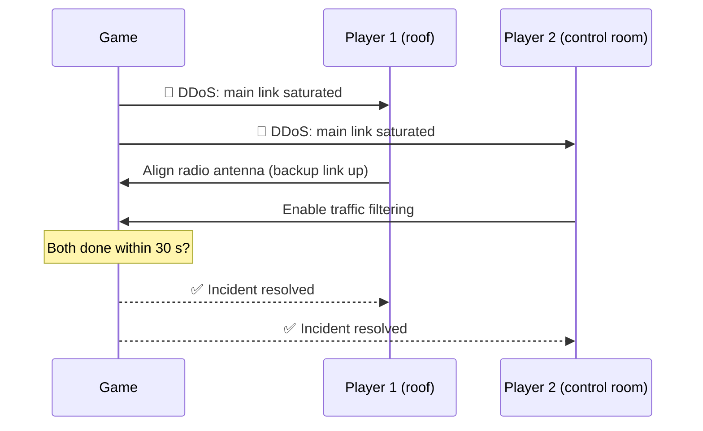

# Idea: multiplayer

Parked for M3. v1 is single player; see [contract.md](../contract.md#3-player-mode-single-player-first).

## Open question

The original idea notes ended with: "2 player mechanic, one attacks and one attacks". Probably a typo. Two readings:

- **Co-op:** two players defend together (current plan).
- **Versus:** one player is the attacker. A different game, needs its own design.

## Co-op rule

You need to maintain **2 things at once** for an incident to be solved.

## Two-player incidents

- DDoS: switch to radio backup + enable filtering
- Fire: fight fire + fail over traffic
- Ransomware: pull cable + restore backups
- Power crisis: reroute battery + shut down non-critical services
- Supply chain: roll back package + reimage server

## Sequence example: DDoS

## Ideas tied to outdoor areas

- Dock: one player reads serial numbers and seal details over a walkie-talkie, the other checks them against the order email. Neither can verify alone. (see [delivery-dock.md](delivery-dock.md))
- Generator: one player does the cold start, the other watches the battery % and calls the time left. Load shedding together. (see [generator-yard.md](generator-yard.md))
- Combined: grid failure + generator that won't start. One fixes the generator, the other stretches the batteries.

## Rules that keep co-op possible (already in the contract)

1. All state in one `GameState` class.
2. Actions go through methods like `player.TryFix(incident)`.
3. Scene nodes show state, they do not own it.
