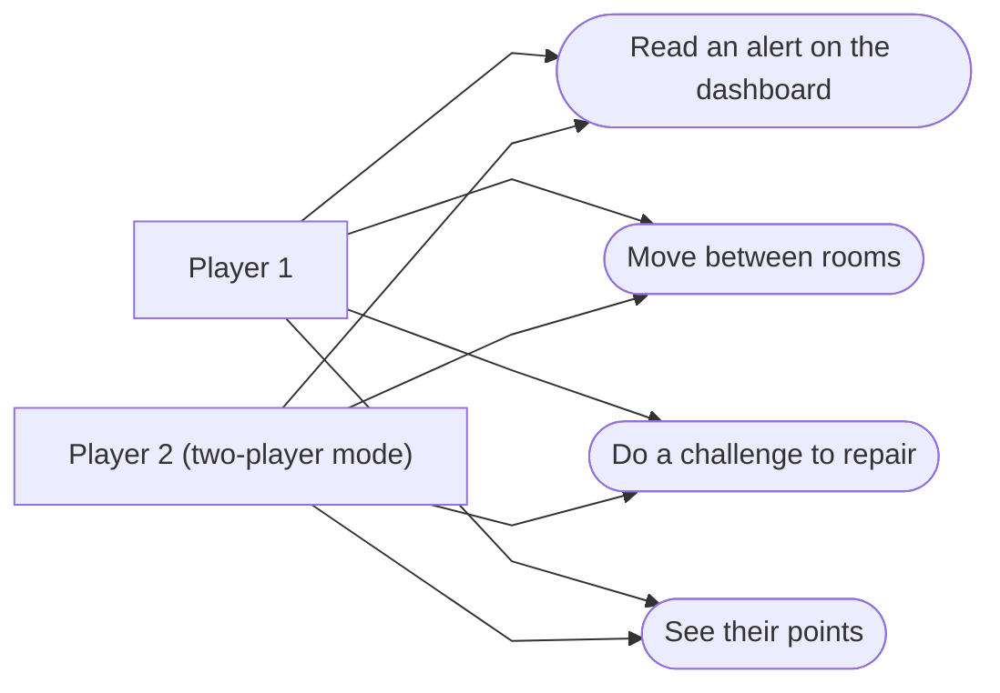

# Challenges and player actions

Completes the [game diagram](game-states.md). The challenges come from [incidents.md](../ideas/incidents.md), simplified.

## 1. What each player can do (use cases)

## 2. List of challenges (proposal)

| #   | Problem            | Alert on the dashboard        | Where to repair              | What the player does                                       | Points |
| --- | ------------------ | ----------------------------- | ---------------------------- | ---------------------------------------------------------- | ------ |
| 1   | Security attack    | "Too many suspicious visits!" | Control room                 | Turn on the filter on the computer                         | 150    |
| 2   | Broken hard drive  | "A disk is not responding"    | Server room                  | Find the red disk and replace it                           | 100    |
| 3   | Overheating server | "Temperature too high"        | Server room                  | Restart the air conditioning                               | 100    |
| 4   | Fire               | "Fire alarm!"                 | Server room                  | Grab the extinguisher and put out the fire                 | 200    |
| 5   | Unplugged cable    | "A server is offline"         | Server room                  | Find the right cable and plug it back in                   | 100    |
| 6   | Fake e-mail        | "New urgent message"          | Control room                 | Spot that the e-mail is fake and report it                 | 100    |
| 7   | Electrical fault   | "Power fault in the basement" | Control room (Admin → Power) | Cut power to the faulty circuit. Ignored: it starts a Fire | 150    |

In two-player mode, both players get the same challenge at the same time. The first one to finish it gets the points.

### Carried items (proposal, to validate with the team)

- The player holds one item at a time, in the right hand of the first-person view. Only the extinguisher can be picked up for now.
- **E** next to the extinguisher picks it up. **E** near the fire with the extinguisher in hand puts it out.
- **Q** hangs the extinguisher back on its bracket.
- Code: `game-core/PlayerProfile.cs` (`Holding`), `dusk-till-dawn/main/fire/ExtinguisherSpot.cs`.

## 3. Points rule (proposal, to validate with the team)

| Case                                      | Points                                     | Example (challenge worth 100) |
| ----------------------------------------- | ------------------------------------------ | ----------------------------- |
| Repaired with at least half the time left | Base points + 50 %                         | +150                          |
| Repaired later                            | Base points                                | +100                          |
| Failed (time ran out)                     | Every player loses 50 % of the base points | −50                           |

- Points never go below 0.
- The +50 % bonus follows `docs/game-v1.md`: reading the dashboard early pays.
- Code: `game-core/PointsRule.cs`.

## 4. Challenges per night (proposal, to validate with the team)

Our six challenges mapped to the v1 incidents (`docs/game-v1.md` §8):
Security attack = DDoS (#2), Broken hard drive = Failing hard drive (#7),
Overheating server and Fire = Cooling failure → fire (#6), Fake e-mail = Phishing (#8).
Unplugged cable is not in the v1 list. TLS (#1), dependency (#3), bad update (#4) and solar panels (#5) are not built yet.

| Night | Challenges | One new challenge every | v1 table (§9) |
|---|---|---|---|
| 1 | Broken hard drive, Security attack, Overheating server | 180 s (3 min) | 1 every ~3 min |
| 2 | + Fake e-mail | 150 s | 1 every ~2.5 min |
| 3 | + Unplugged cable | 120 s | 1 every ~2 min |
| 4 | + Fire (all six) | 90 s | 1 every ~90 s |
| 5 | All six | 75 s | 1 every ~75 s |

- A night lasts 10 real minutes, so night 1 gets about 3 challenges and night 5 about 8.
- Fire spawns on its own from night 4; before that it only comes from Electrical faults (`ElectricalFaultRisk`).
- Two challenges overlapping on night 5 is not built: one challenge runs at a time.
- The game only plays night 1 for now; nights 2 to 5 come with the shop (#64).
- Code: `game-core/NightPlan.cs`.
