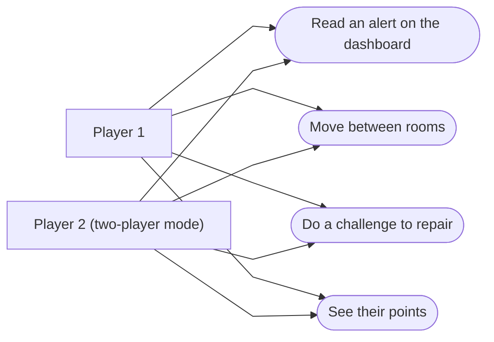

# Challenges and player actions

Completes the [game diagram](game-states.md). The challenges come from [incidents.md](../ideas/incidents.md), simplified.

## 1. What each player can do (use cases)

## 2. List of challenges (proposal)

| # | Problem | Alert on the dashboard | Where to repair | What the player does | Points |
|---|---|---|---|---|---|
| 1 | Security attack | "Too many suspicious visits!" | Control room | Turn on the filter on the computer | 150 |
| 2 | Broken hard drive | "A disk is not responding" | Server room | Find the red disk and replace it | 100 |
| 3 | Overheating server | "Temperature too high" | Server room | Restart the air conditioning | 100 |
| 4 | Fire | "Fire alarm!" | Server room | Grab the extinguisher and put out the fire | 200 |
| 5 | Unplugged cable | "A server is offline" | Server room | Find the right cable and plug it back in | 100 |
| 6 | Fake e-mail | "New urgent message" | Control room | Spot that the e-mail is fake and report it | 100 |

In two-player mode, both players get the same challenge at the same time. The first one to finish it gets the points.
