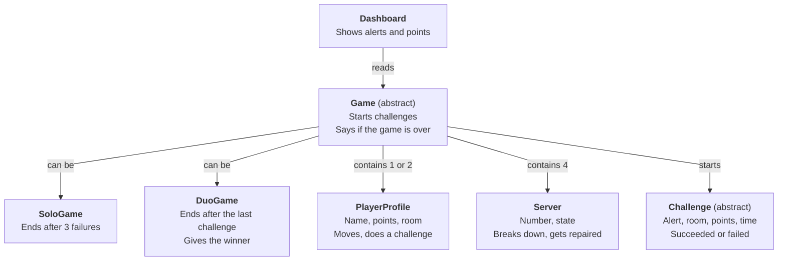
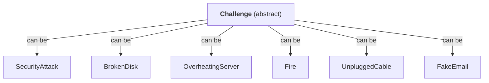
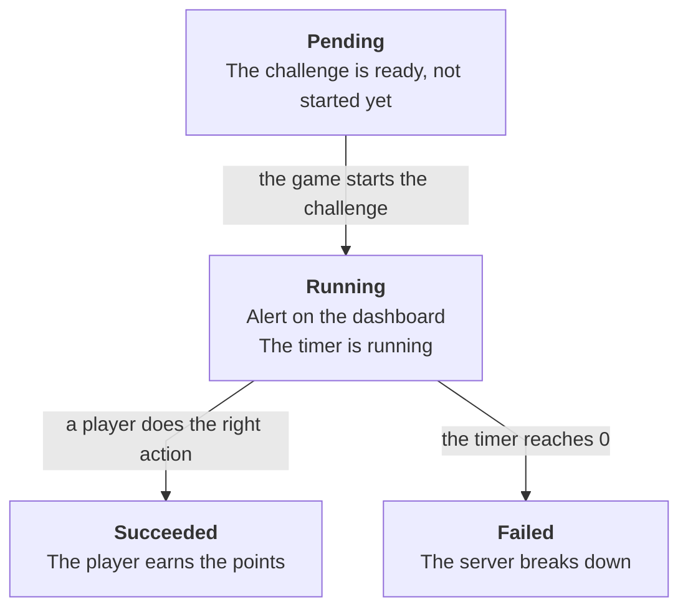

# Class diagram (object-oriented)

The classes to write in C#. They come from the [game diagram](game-states.md), the [list of challenges](challenges.md) and the [dashboard](dashboard.md).

Read it top to bottom: "The dashboard reads the game", "A game contains players", etc.

## 1. Main classes

## 2. Challenges

## 3. States of a challenge (state machine)

A challenge is always in **exactly one state**. On every tick, the game moves its challenges forward.

| State | What happens on each tick |
|---|---|
| Pending | Nothing |
| Running | The time remaining goes down. If it reaches 0, the challenge becomes "Failed". |
| Succeeded / Failed | Nothing. It is over, the challenge does not change anymore. |

In two-player mode it is the same challenge: the first player who does the right action makes it "Succeeded".

## 4. Object-oriented ideas used

| Idea | Where in the diagram |
|---|---|
| **Inheritance** | `SoloGame` and `DuoGame` inherit from `Game`. Each challenge inherits from `Challenge`. |
| **Abstract class** | `Game` and `Challenge`: never created on their own, only their children. |
| **Polymorphism** | "Is the game over?": in solo after 3 failures, in duo after the last challenge. Same question, different answer. |
| **Encapsulation** | A player's points only change through a method, never directly. |
| **Composition** | A `Game` contains its players and its servers. If the game stops, they go away with it. |
| **Separation** | `Dashboard` reads the game but never changes it (rule from the [contract](../contract.md)). |
