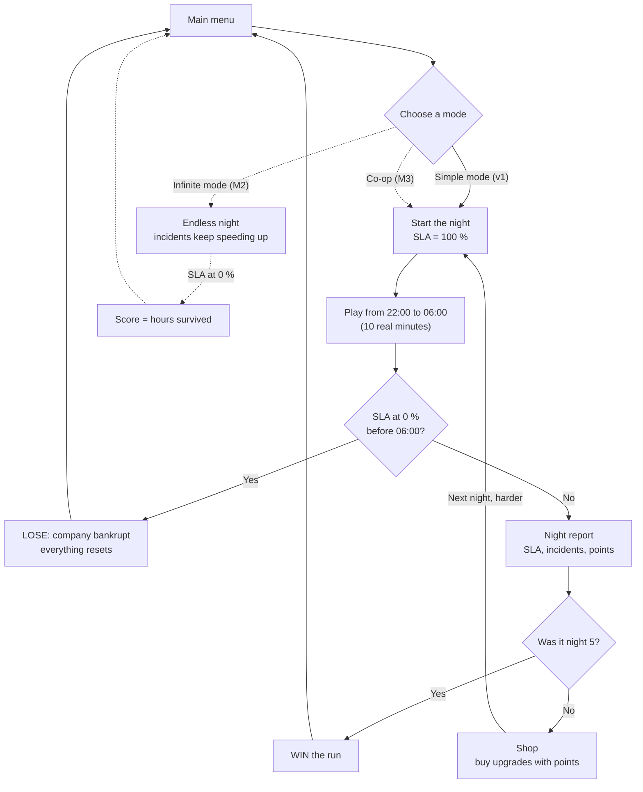
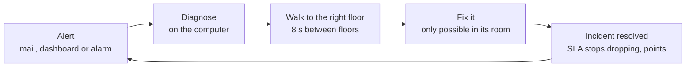
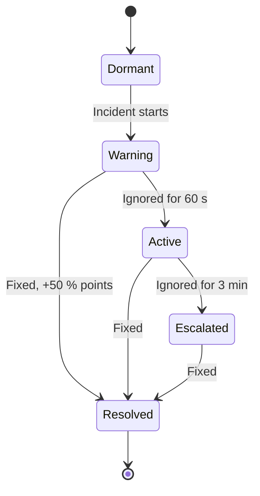
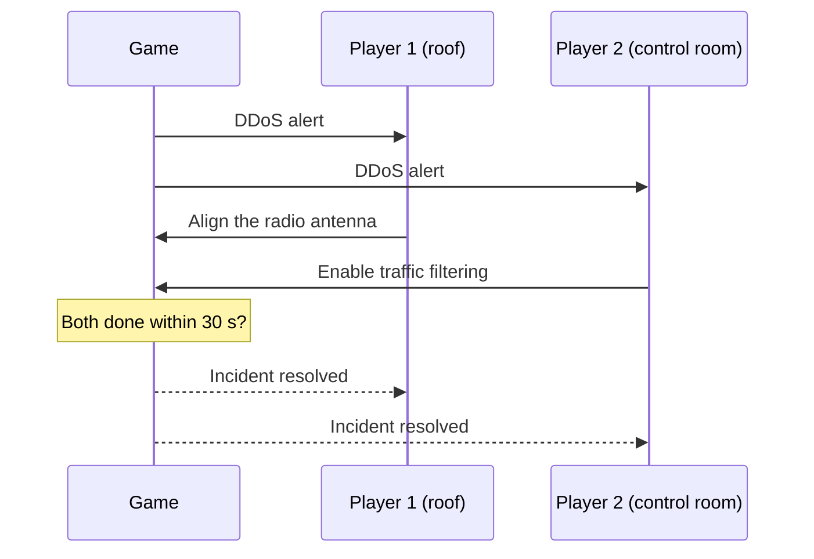

# Player flow

How the game runs from the main menu to the end. Numbers and rules come from [game-v1.md](../game-v1.md). If they change, change them there first.

**v1 is simple mode with one player.** Dashed arrows are later milestones.

## 1. The whole game

## 2. What the player does during a night

This loop takes about 1 minute and repeats until the night ends.

Other incidents keep coming while the player walks. This is the main pressure.

## 3. The states of an incident

| State | SLA | Player sees |
|---|---|---|
| Warning | No loss | Mail or dashboard hint |
| Active | Drops, at the rate in the incident's data file | Alarm, red on the dashboard |
| Escalated | Drops twice as fast, may start a cascade | Louder alarm, extra effects |
| Resolved | Stops dropping | Green, points |

## 4. Gains and losses

| Gains | Losses |
|---|---|
| Points for each resolved incident | SLA drops for each active incident |
| +50 % points if fixed during Warning | SLA drops twice as fast when escalated |
| +200 points for surviving the night | Extra -1 % per in-game minute when servers are down |
| +1 point per SLA % left | SLA at 0 %: the run ends and everything resets |
| Upgrades stay for the whole run | |

## 5. Multiplayer (M3, not in v1)

Two players defend the same building. The game flow stays the same, but some incidents need **both players to act at once**. Example from [multiplayer.md](../ideas/multiplayer.md):

