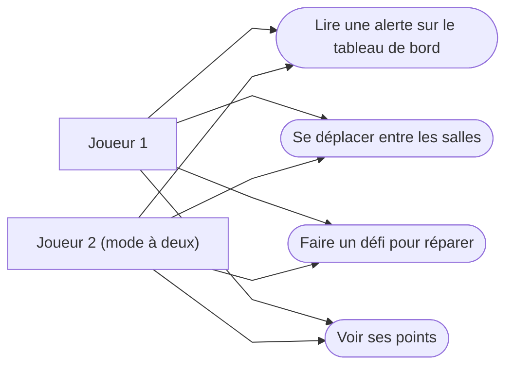

# Défis et actions du joueur

Complète le [diagramme du jeu](game-states.md). Les défis viennent de [incidents.md](../ideas/incidents.md), simplifiés.

## 1. Ce que chaque joueur peut faire (cas d'utilisation)

## 2. Liste des défis (proposition)

| # | Problème | Alerte sur le tableau de bord | Où réparer | Ce que fait le joueur | Points |
|---|---|---|---|---|---|
| 1 | Attaque de sécurité | « Trop de visites suspectes ! » | Salle de contrôle | Activer le filtre sur l'ordinateur | 150 |
| 2 | Disque dur cassé | « Un disque ne répond plus » | Salle des serveurs | Trouver le disque rouge et le changer | 100 |
| 3 | Serveur trop chaud | « Température trop haute » | Salle des serveurs | Redémarrer la climatisation | 100 |
| 4 | Feu | « Alarme incendie ! » | Salle des serveurs | Prendre l'extincteur et éteindre le feu | 200 |
| 5 | Câble débranché | « Un serveur est hors ligne » | Salle des serveurs | Trouver le bon câble et le rebrancher | 100 |
| 6 | Faux e-mail | « Nouveau message urgent » | Salle de contrôle | Repérer que l'e-mail est faux et le signaler | 100 |

En mode à deux, les deux joueurs reçoivent le même défi en même temps. Le premier qui le finit gagne les points.
