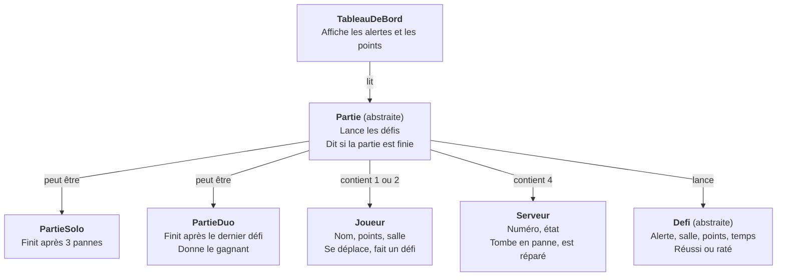
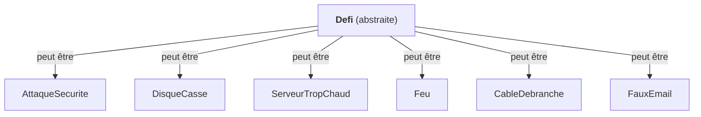

# Diagramme de classes (orienté objet)

Les classes à coder en C#. Elles viennent du [diagramme du jeu](game-states.md), de la [liste des défis](defis.md) et du [tableau de bord](tableau-de-bord.md).

Se lit de haut en bas : « Le tableau de bord lit la partie », « Une partie contient des joueurs », etc.

## 1. Les classes principales

## 2. Les défis

## 3. Les idées orientées objet utilisées

| Idée | Où dans le diagramme |
|---|---|
| **Héritage** | `PartieSolo` et `PartieDuo` héritent de `Partie`. Chaque défi hérite de `Defi`. |
| **Classe abstraite** | `Partie` et `Defi` : on ne les crée jamais seules, seulement leurs enfants. |
| **Polymorphisme** | « La partie est-elle finie ? » : en solo après 3 pannes, en duo après le dernier défi. Même question, réponse différente. |
| **Encapsulation** | Les points d'un joueur changent seulement par une méthode, jamais directement. |
| **Composition** | Une `Partie` contient ses joueurs et ses serveurs. Si la partie s'arrête, ils disparaissent avec elle. |
| **Séparation** | `TableauDeBord` lit la partie mais ne la modifie jamais (règle du [contrat](../contract.md)). |

## À décider ensemble

- Noms en français ou en anglais dans le code ? Le code actuel est en anglais (`GameState`).
